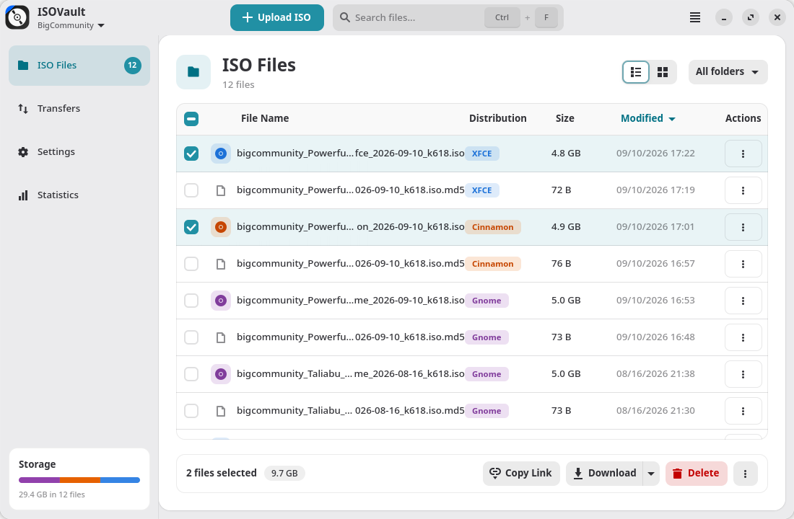
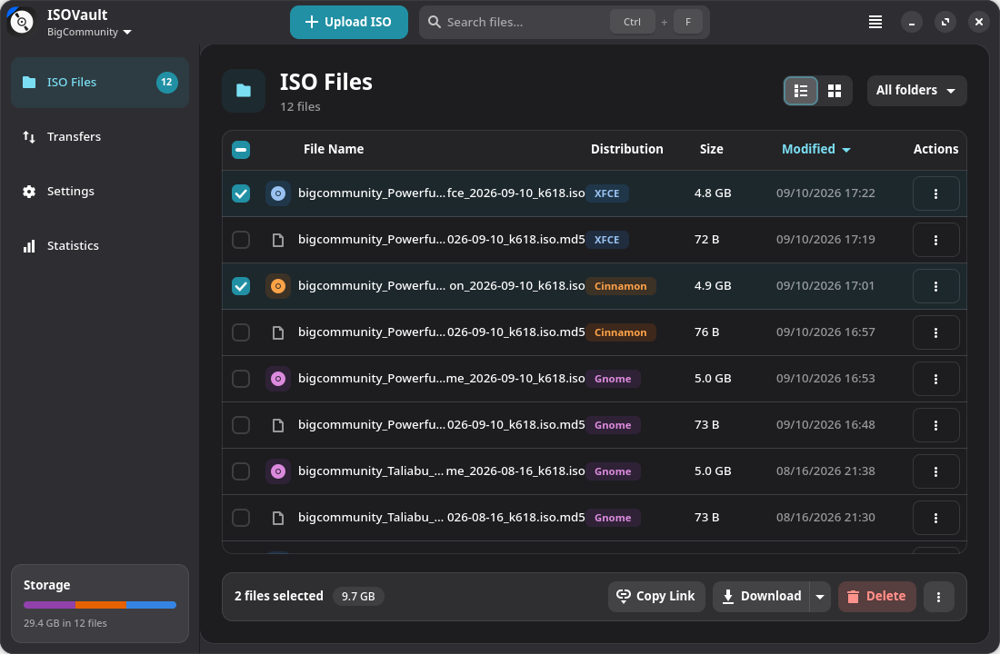
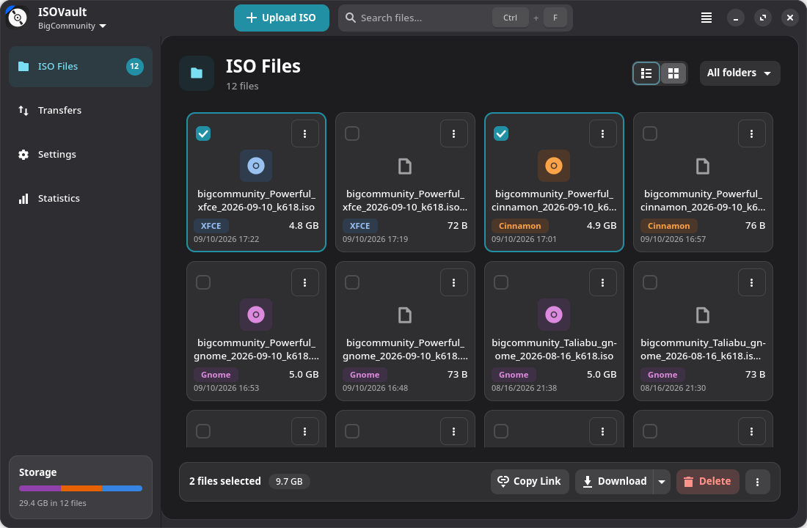
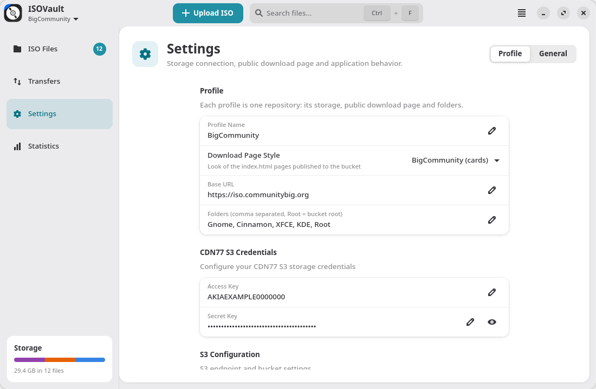
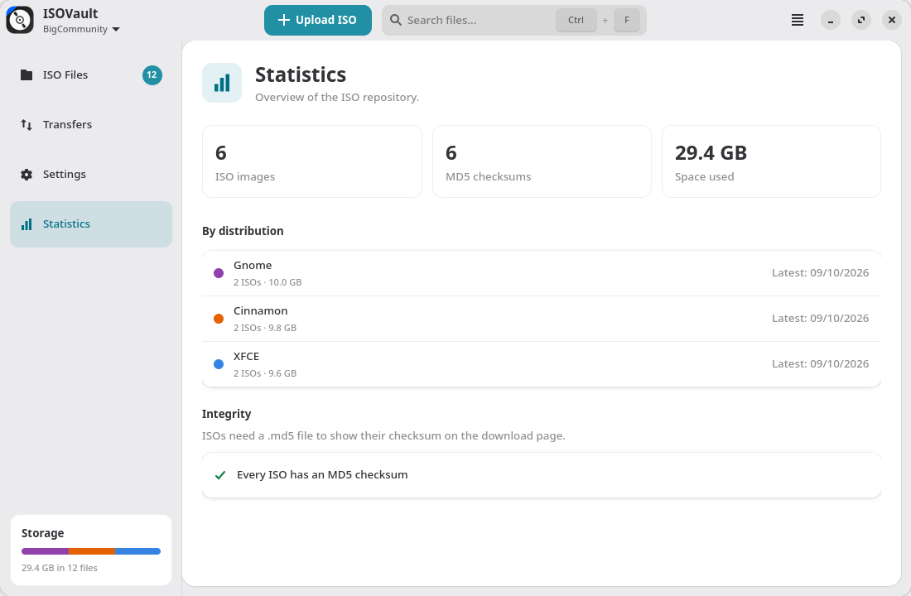
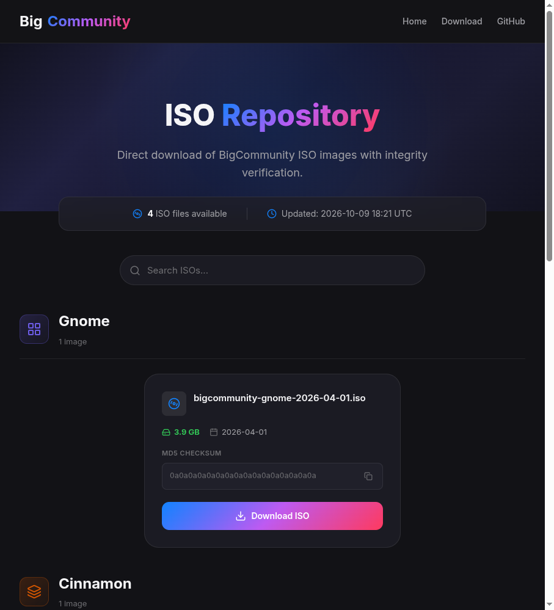
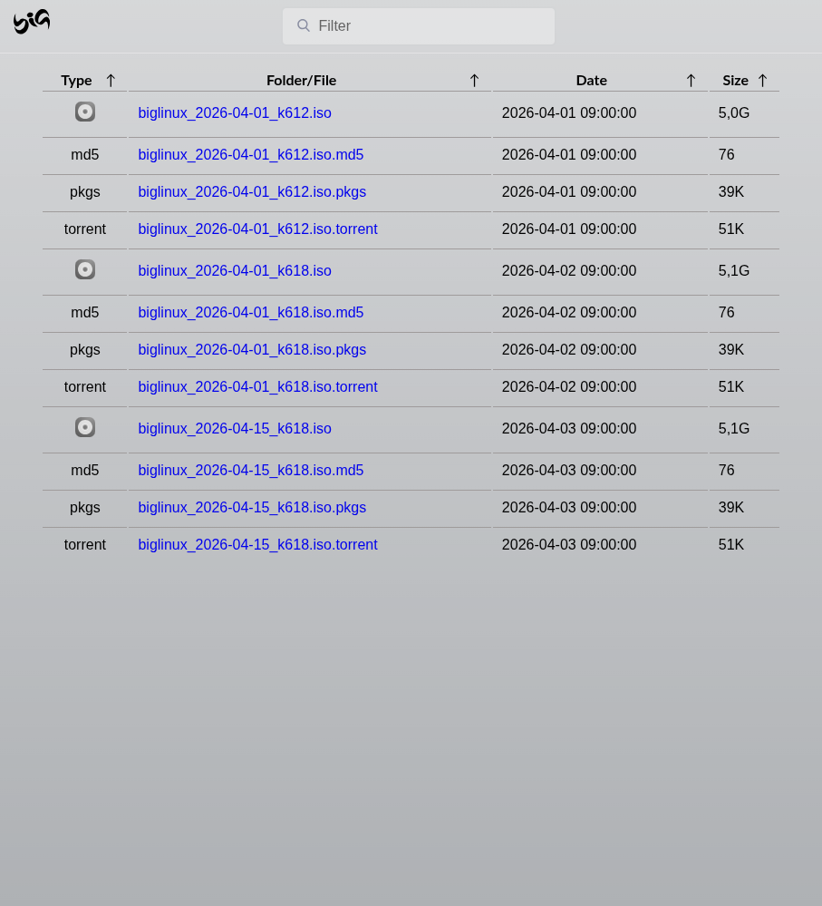

<div align="center">


# ISOVault

**Manage Linux ISO repositories on S3 storage — upload, verify and publish them from a native GNOME app.**

[](LICENSE)
[](https://www.python.org/)
[](https://www.gtk.org/)
[](https://gnome.pages.gitlab.gnome.org/libadwaita/)
[](https://communitybig.org)
[](locale/)
[](https://communitybig.org)
[](https://www.biglinux.com.br)



</div>

## Overview

ISOVault is the desktop tool the BigCommunity and BigLinux teams use to
maintain their ISO repositories, such as
[iso.communitybig.org](https://iso.communitybig.org) and
[iso.biglinux.com.br](https://iso.biglinux.com.br). It works with any
S3-compatible bucket (CDN77 by default): upload images and their checksums,
organize them in folders per desktop edition and keep the public download
page up to date automatically.

## Features

- **Profiles** — one per repository, each with its own bucket and
  credentials, public URL, folders and download page style. *BigCommunity*
  and *BigLinux* profiles are included; switch between them from the header.
- **Two download page styles** — BigCommunity cards with the MD5 checksum of
  every image, or the BigLinux file list with ISO, `.md5`, `.pkgs` and
  `.torrent` files.
- **Upload with a destination picker** — GNOME, Cinnamon, XFCE, KDE Plasma or
  the bucket root (the folders come from the profile). Invalid files are
  listed before anything is sent, and the last folder used is remembered.
- **Multiple selection** — check boxes, *Select All*, Shift/Ctrl+click: copy
  links, download or delete many files at once. A failing file never stops the
  rest of a batch.
- **List and grid views** with instant search, folder filter and sorting by
  name, distribution, size or date.
- **Transfers** — progress and history of the uploads, downloads and
  deletions made in the session.
- **Statistics** — images and space per distribution, plus the ISOs that are
  still missing a checksum.
- **Safe by default** — confirmation before deleting, a private settings file
  (`0600`) and credentials mirrored in the system keyring.
- **Native look** — GTK 4 and libadwaita, follows the system light or dark
  theme, translated into 28 languages.

## Screenshots

<table>
  <tr>
    <td align="center"><br><sub>File list in the dark theme</sub></td>
    <td align="center"><br><sub>Grid view</sub></td>
  </tr>
  <tr>
    <td align="center"><br><sub>Profile settings</sub></td>
    <td align="center"><br><sub>Statistics</sub></td>
  </tr>
</table>

### Download page styles

Each profile publishes an `index.html` for the whole repository and one for
each folder, in one of two styles:

<table>
  <tr>
    <td align="center"><br><sub><b>BigCommunity</b> — cards per edition with the MD5 checksum and a copy button</sub></td>
    <td align="center"><br><sub><b>BigLinux</b> — sortable file list with a filter, as on iso.biglinux.com.br</sub></td>
  </tr>
</table>

## Installation

### BigCommunity / Arch Linux

ISOVault is packaged for BigCommunity. To build the package from this
repository:

```bash
git clone https://github.com/big-comm/isovault.git
cd isovault/pkgbuild
makepkg -si
```

### Dependencies

| Package | Purpose |
|---|---|
| `gtk4`, `libadwaita` (1.7+) | User interface |
| `python` (3.10+), `python-gobject` | Runtime |
| `python-boto3` | S3 access |
| `libsecret` *(optional)* | Store the credentials in the system keyring |

## Usage

1. Choose a profile from the menu under the app name, or create one in
   **Settings → Profile → New Profile**.
2. In **Settings → Profile**, fill in the access key, secret key, endpoint and
   bucket, then press **Test Connection**.
3. Press **Upload ISO**, pick the `.iso` and its checksum, and choose the
   destination folder.
4. The download page is regenerated after every change, or on demand with
   **Force Update Index** in the main menu.

### Profiles

| Setting | Meaning |
|---|---|
| Profile Name | Shown in the header menu |
| Download Page Style | *BigCommunity (cards)* or *BigLinux (file list)* |
| Base URL | Public address of the bucket, used for links and the download page |
| Folders | Comma-separated bucket folders; `Root` is the bucket root |
| Access Key, Secret Key, Endpoint URL, Region, Bucket Name | S3 connection |

| Profile | Base URL | Style | Folders |
|---|---|---|---|
| BigCommunity | `https://iso.communitybig.org` | Cards | Gnome, Cinnamon, XFCE, KDE, Root |
| BigLinux | `https://iso.biglinux.com.br` | File list | Root |

Settings and profiles are stored in `~/.config/isovault.conf` (mode `0600`).
Configurations from older versions become the *BigCommunity* profile
automatically.

### Keyboard shortcuts

| Shortcut | Action |
|---|---|
| <kbd>Ctrl</kbd>+<kbd>F</kbd> | Search files |
| <kbd>Ctrl</kbd>+<kbd>A</kbd> | Select all files |
| <kbd>Ctrl</kbd>+<kbd>R</kbd> / <kbd>F5</kbd> | Refresh |
| <kbd>Ctrl</kbd>+<kbd>,</kbd> | Settings |
| <kbd>Ctrl</kbd>+<kbd>Q</kbd> | Quit |

## Development

```bash
python3 usr/share/isovault/main.py --debug          # run from the source tree
python3 -m pytest                                   # tests (GTK tests are skipped without a display)
ruff check usr tests tools
python3 tools/render_preview.py page.html biglinux  # preview a download page style with sample data
```

```
usr/share/isovault/
├── main.py         application, CLI options and shortcuts
├── config.py       constants: app id, built-in profiles, page styles
├── models/         settings and profiles (private INI file + keyring), FileItem
├── services/       S3 access, download page generators, index publishing, validation
├── templates/      download pages: BigCommunity cards and biglinux/ file list
├── ui/             main window, file browser, pages, dialogs, stylesheet
└── utils/          MD5 parsing/pairing, size formatting, i18n
```

Translations live in [`locale/`](locale/) as gettext `.po` files; the compiled
catalogs are in `usr/share/locale/`.

## License

ISOVault is released under the [MIT License](LICENSE).

<div align="center">
<sub>Made with ❤ by the <a href="https://communitybig.org">BigCommunity</a> and <a href="https://www.biglinux.com.br">BigLinux</a> teams.</sub>
</div>
